# Домашнее задание к занятию 4 «Оркестрация группой Docker контейнеров на примере Docker Compose» - Розаев А.Ю.

### Инструкция к выполению

1. Для выполнения заданий обязательно ознакомьтесь с [инструкцией](https://github.com/netology-code/devops-materials/blob/master/cloudwork.MD) по экономии облачных ресурсов. Это нужно, чтобы не расходовать средства, полученные в результате использования промокода.
2. Практические задачи выполняйте на личной рабочей станции или созданной вами ранее ВМ в облаке.
3. Своё решение к задачам оформите в вашем GitHub репозитории в формате markdown!!!
4. В личном кабинете отправьте на проверку ссылку на .md-файл в вашем репозитории.

---

## Задача 1

Ответ в виде ссылки на hub.docker.com
[docker_hub](https://hub.docker.com/repository/docker/expgt/custom-nginx/general)

---

## Задача 2

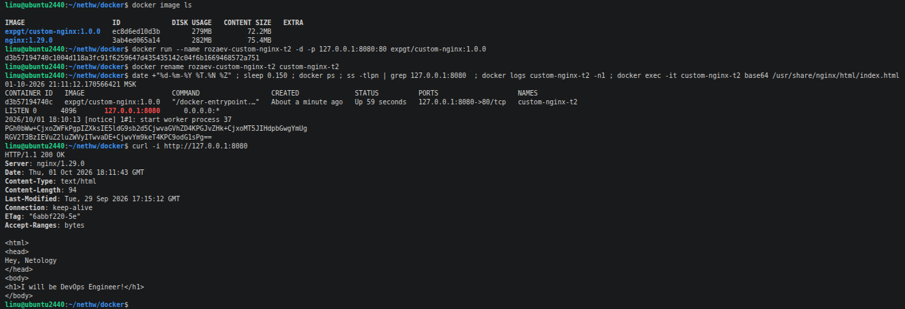

---

## Задача 3

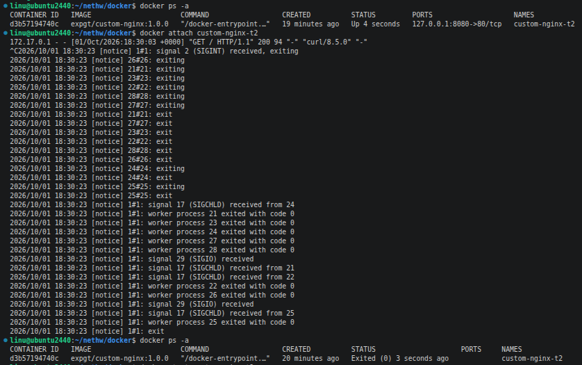

Комбинация Ctrl + C отправляет сигнал SIGINT (сигнал прерывания) главному процессу внутри контейнера (этому процессу всегда присваивается PID 1).
Так как Docker-контейнер живет ровно столько, сколько живет его главный процесс, завершение этого процесса приводит к немедленной остановке всего контейнера
и статус контейнера изменяется на Exited.

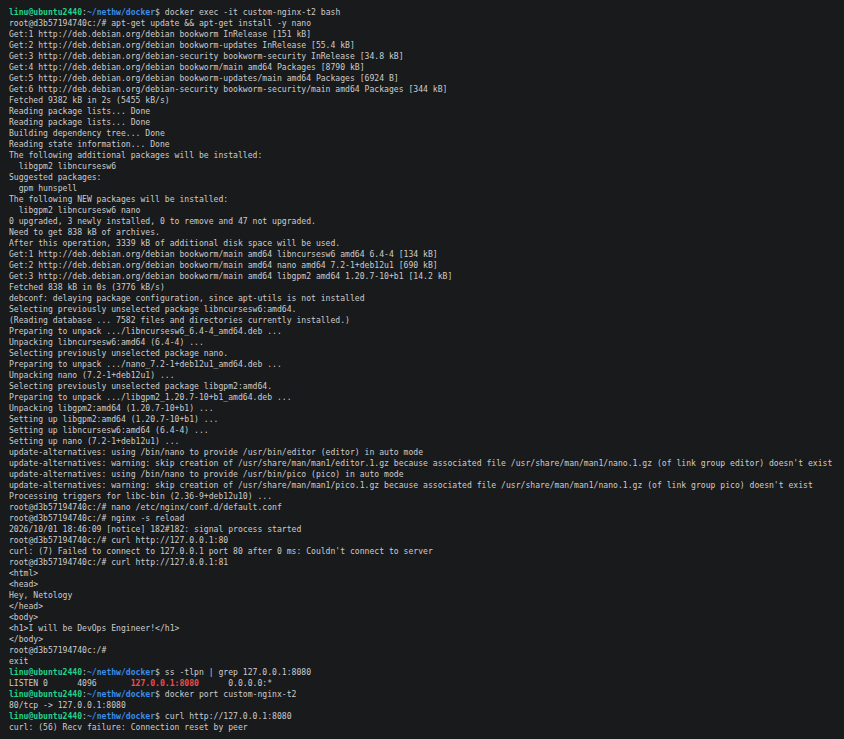

Возникшая проблема заключается в рассинхронизации сетевых настроек Docker и конфигурации Nginx внутри контейнера.
После изменения порта на 81 цепочка проброса портов (Port Mapping) разорвалась.
Снаружи компонент docker-proxy принимает curl запрос на порту 8080 и, согласно старым правилам запуска, перенаправляет его внутрь контейнера на порт 80.
Внутри контейнера после изменения default.conf и выполнения nginx -s reload веб-сервер Nginx ожидает трафик на порту 81.

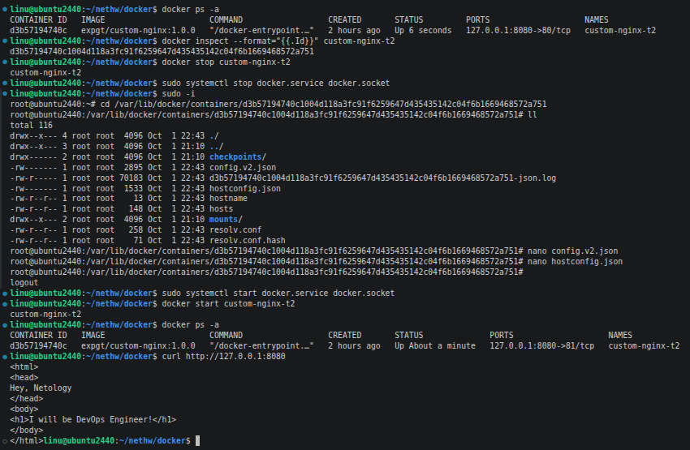

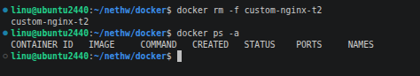

---

## Задача 4


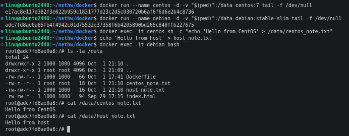

---

## Задача 5

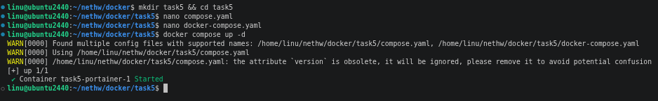

По умолчанию файлы конфигурации Compose - это compose.yaml или compose.yml.
Для обратной совместимости Compose также поддерживает docker-compose.yaml и docker-compose.yml, но у них приоритет ниже.
Если в директории находятся оба файла, то Compose первым выберет compose.yaml:
1. compose.yaml (самый высокий приоритет)
2. compose.yml
3. docker-compose.yaml
4. docker-compose.yml (самый низкий приоритет)

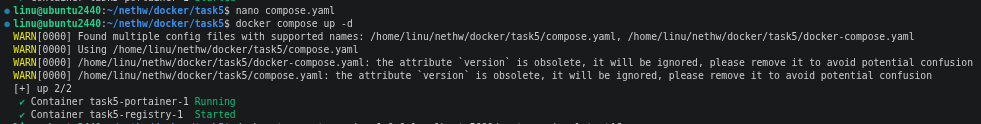

В файл compose.yaml добавлена секция
```bash
include:
  - path: docker-compose.yaml
```

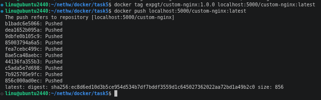

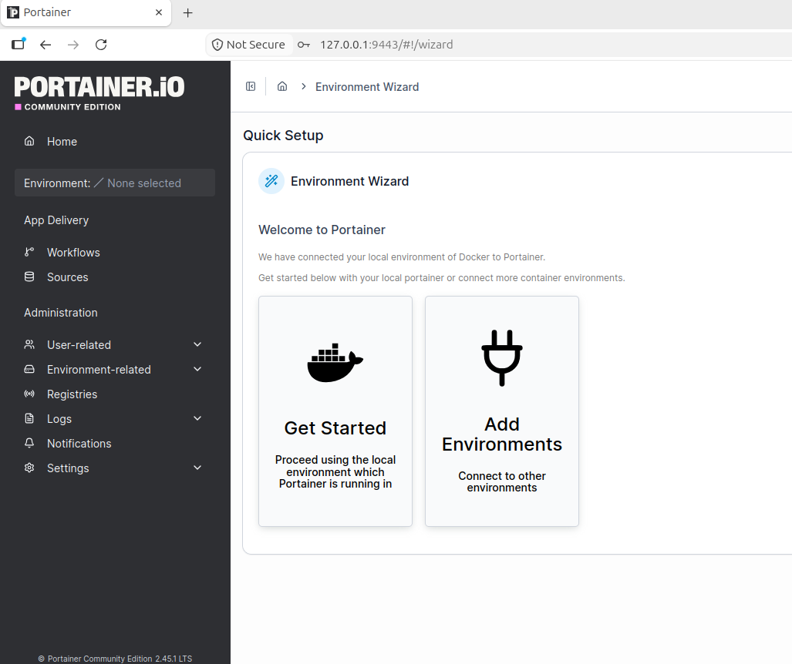

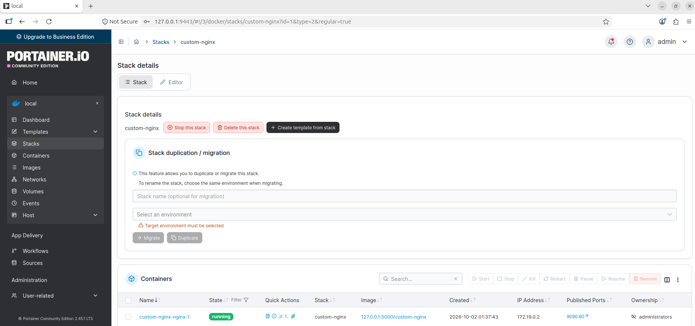

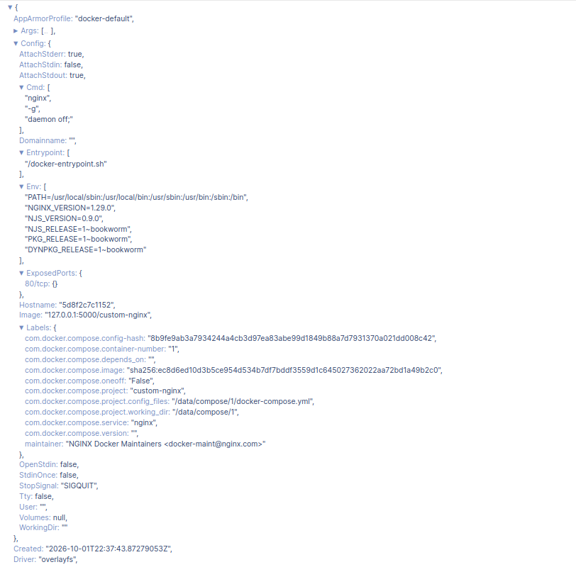

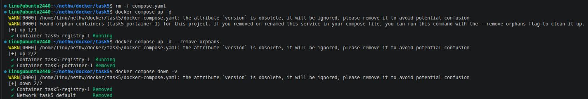

После удаления файла compose.yaml в директории остался только второй файл — docker-compose.yaml.
Compose видит, что в системе всё ещё запущены локальные контейнеры, привязанные к этой директории, но в оставшемся файле docker-compose.yaml их описания нет. 
Он помечает такие контейнеры как "orphan" (сироты) и сообщает, что если эти контейнеры не нужны, то их можно удалить командой docker compose up -d --remove-orphans.

---

### Правила приема

Домашнее задание выполните в файле readme.md в GitHub-репозитории. В личном кабинете отправьте на проверку ссылку на .md-файл в вашем репозитории.


